<div align="center">

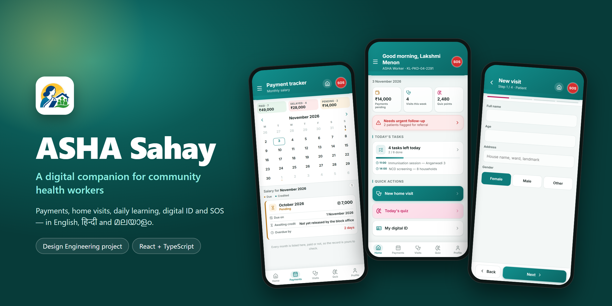

# ASHA Sahay

**A digital companion for India's ASHA community health workers.**
Salary tracking, guided home visits, daily learning, a verifiable digital ID and a one-hold SOS, in English, हिन्दी and മലയാളം.

[**Live demo →**](https://asha-sahay.netlify.app) &nbsp;·&nbsp; [Features](#features) &nbsp;·&nbsp; [Screens](#screens) &nbsp;·&nbsp; [Run locally](#run-locally) &nbsp;·&nbsp; [How it was made](#how-it-was-made)


</div>

---

## About

**ASHAs** (Accredited Social Health Activists) are the first point of contact with the health system
for millions of households in rural India. Their work is mostly on foot and on paper: home visits,
screenings and immunisation drives, paid through incentives that often arrive late and are hard to trace.

ASHA Sahay is a **Design Engineering college project** that asks what a phone app built around
an ASHA's day could look like. We researched the role, mapped the pain points, and designed five
features around them, then built a working, clickable prototype.

> [!NOTE]
> This is a **prototype**, not a production app. It uses fictional mock data, has no backend, and
> sends no real alerts. Try it at **[asha-sahay.netlify.app](https://asha-sahay.netlify.app)**.
> Demo login: `KL-PKD-04-2291` / `demo1234`, or tap **Use demo account**.

## Features

| | Feature | What it does |
|---|---|---|
| 💰 | **Salary tracker** | Calendar on top, written record below. Each month is marked paid, pending or delayed, with due date, credit date and how long it's overdue. |
| 🩺 | **Home visit checkup** | A four-step form (patient → vitals → symptoms → referral). Every field is required. Vitals are colour-graded against clinical thresholds, and the app *suggests* whether the patient needs an urgent checkup. The worker always makes the final call. |
| 🧠 | **Daily quiz** | Five questions a day with instant feedback and a short explanation. Points build up and can be **redeemed for cash**. |
| 🪪 | **Profile & digital ID** | Years of service, service history, trainings, NCD screening totals and badges. A **scannable QR ID card** and a **Digital Service Certificate** with a verification code. |
| 🚨 | **SOS** | A red button on every screen. **Press and hold for 1 second** to alert the police and the worker's emergency contact. Releasing early cancels it, so it can't go off by accident. |

Also included: a welcome screen, login and registration, today's tasks, settings, a hamburger
menu, and full support for **English, Hindi and Malayalam**, mock data included.

## Screens

<table>
  <tr>
    <td align="center">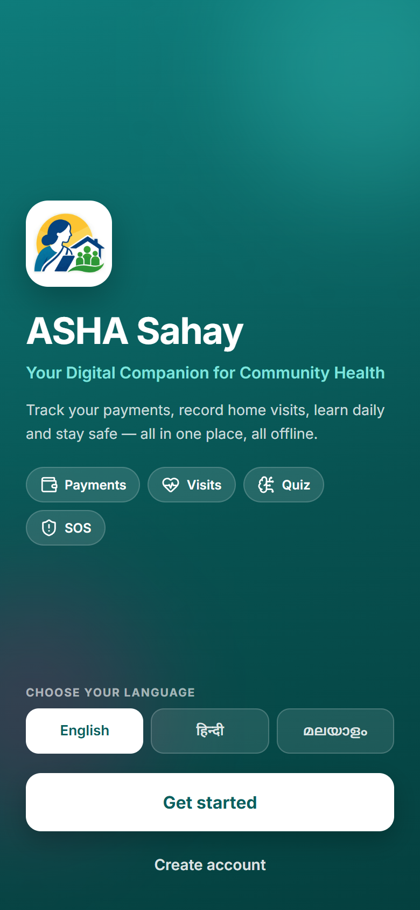<br><sub><b>Welcome</b></sub></td>
    <td align="center">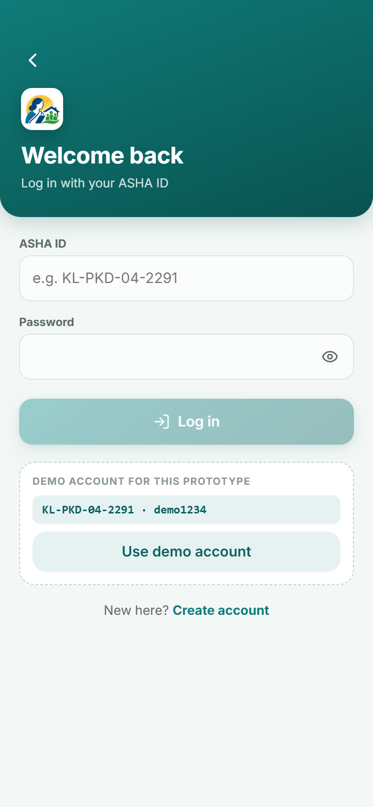<br><sub><b>Login</b></sub></td>
    <td align="center">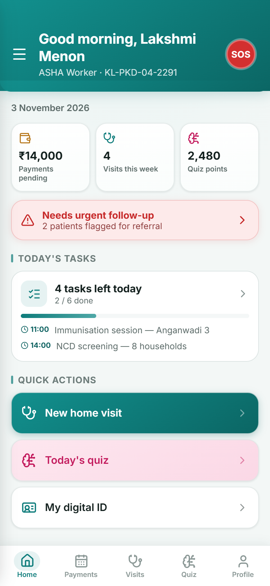<br><sub><b>Home</b></sub></td>
    <td align="center">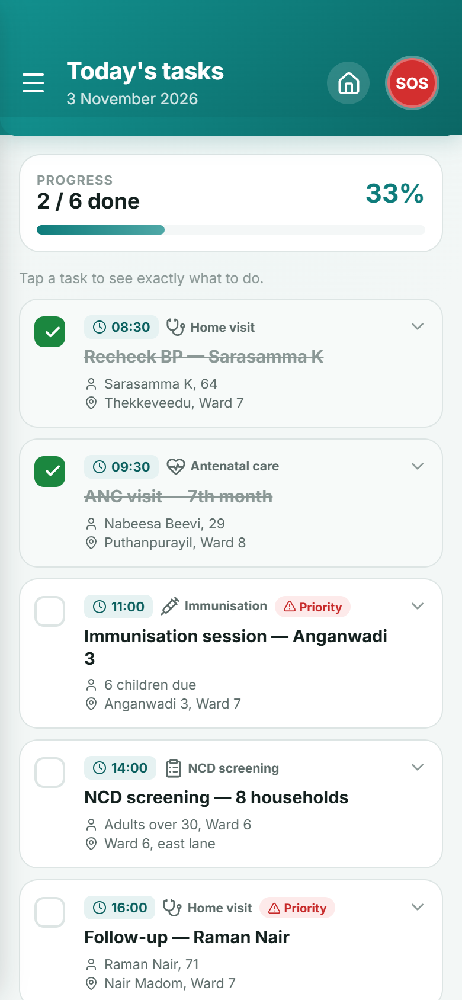<br><sub><b>Today's tasks</b></sub></td>
  </tr>
  <tr>
    <td align="center">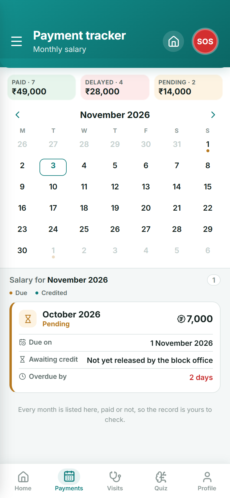<br><sub><b>Salary tracker</b></sub></td>
    <td align="center">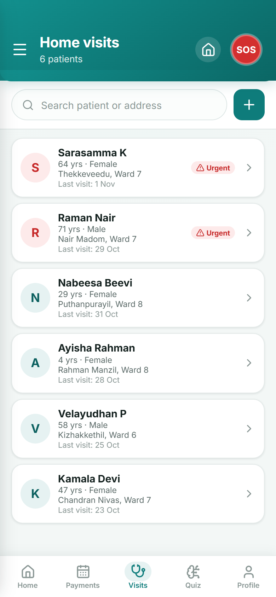<br><sub><b>Home visits</b></sub></td>
    <td align="center">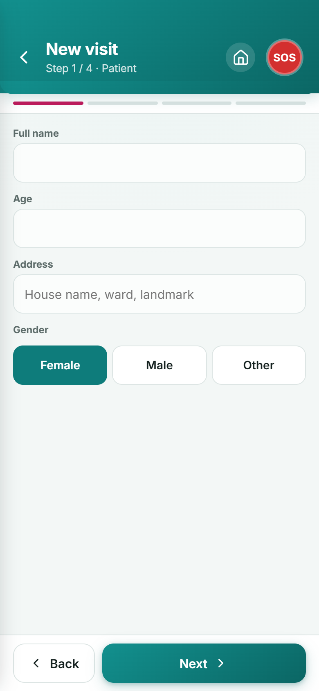<br><sub><b>New visit form</b></sub></td>
    <td align="center">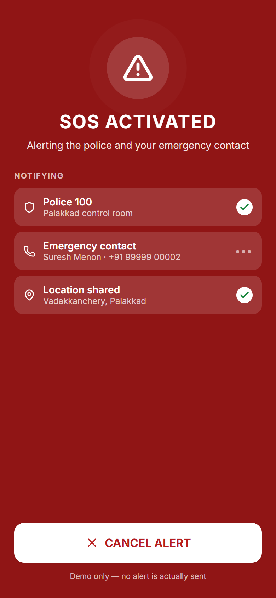<br><sub><b>SOS activated</b></sub></td>
  </tr>
  <tr>
    <td align="center">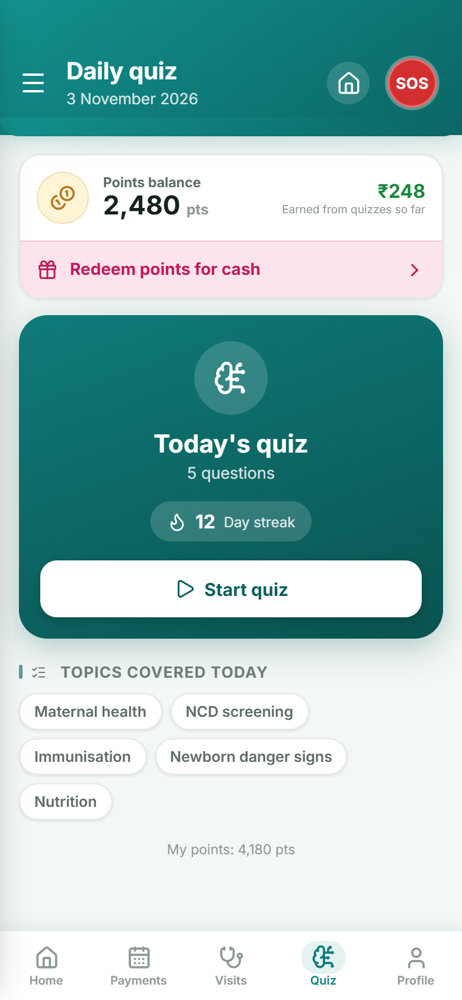<br><sub><b>Daily quiz</b></sub></td>
    <td align="center">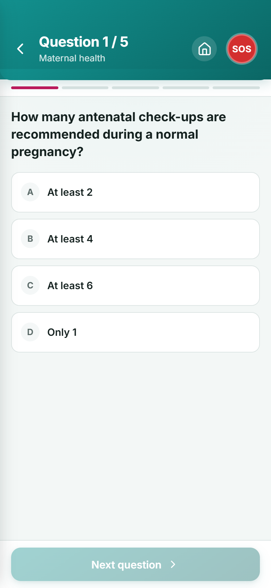<br><sub><b>Question</b></sub></td>
    <td align="center">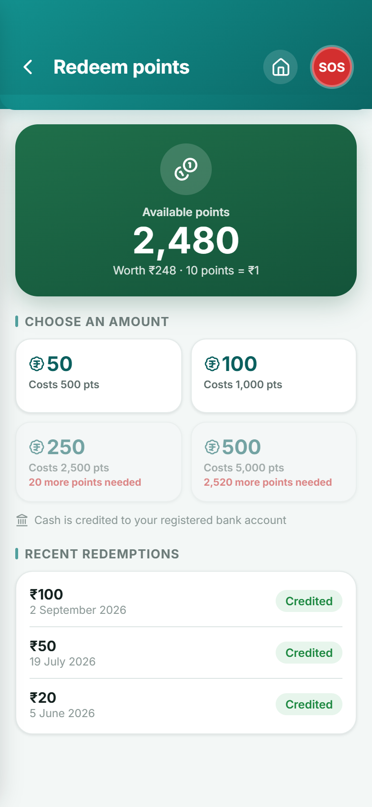<br><sub><b>Redeem points</b></sub></td>
    <td align="center">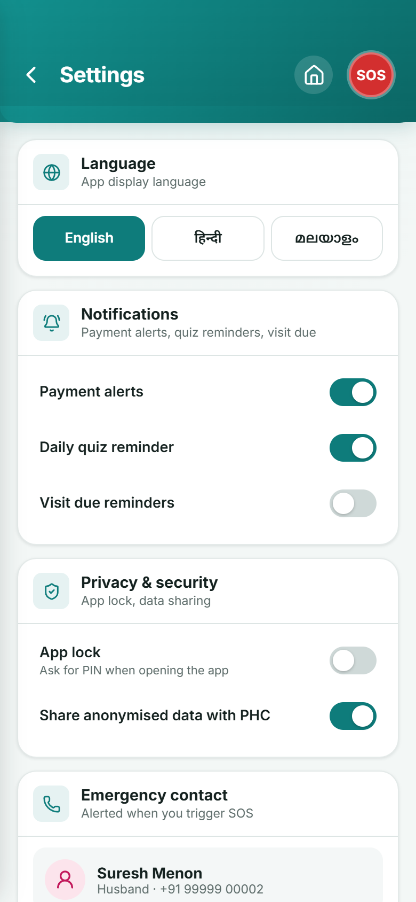<br><sub><b>Settings</b></sub></td>
  </tr>
  <tr>
    <td align="center">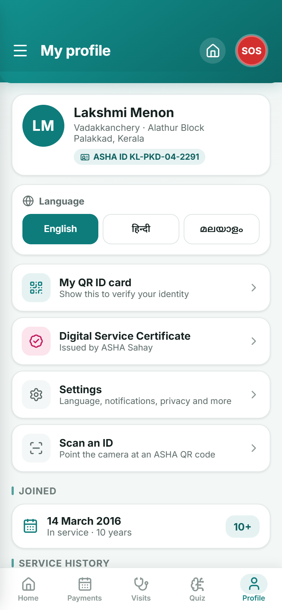<br><sub><b>Profile</b></sub></td>
    <td align="center">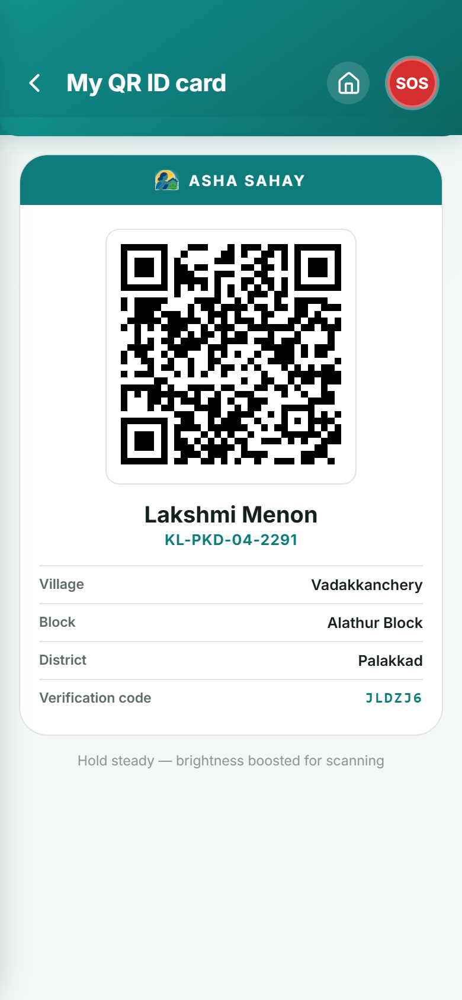<br><sub><b>QR ID card</b></sub></td>
    <td align="center">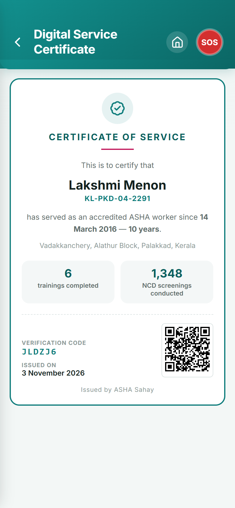<br><sub><b>Service certificate</b></sub></td>
    <td align="center">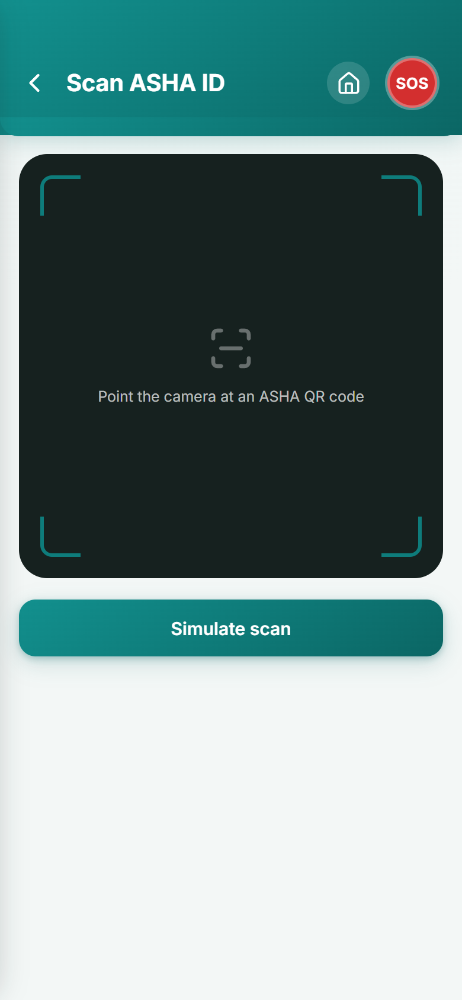<br><sub><b>Scan an ID</b></sub></td>
  </tr>
</table>

### Three languages

<table>
  <tr>
    <td align="center"><br><sub><b>English</b></sub></td>
    <td align="center">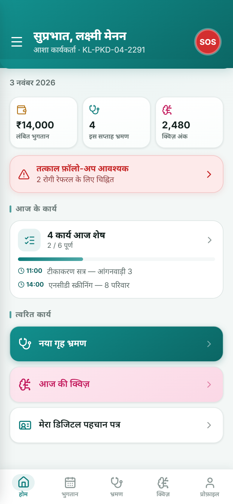<br><sub><b>हिन्दी</b></sub></td>
    <td align="center">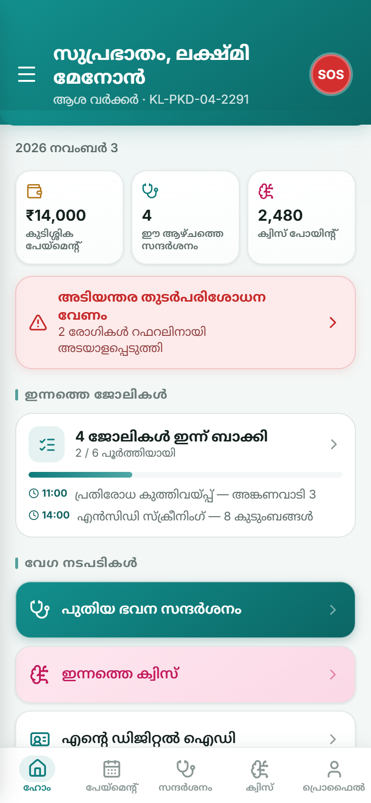<br><sub><b>മലയാളം</b></sub></td>
  </tr>
</table>

### On desktop

On a computer the app opens inside a phone frame. On a phone it fills the screen.

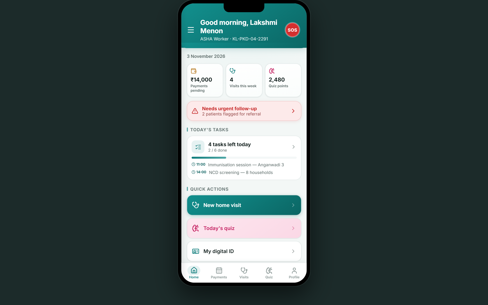

## Design decisions

- **Built for the field.** Large tap targets, high contrast, and one task per screen, because the app is used outdoors, on low-end phones, often in a hurry.
- **Local language first.** The language picker is the first thing on the welcome screen. Every string, including mock data, exists in all three languages.
- **Suggest, don't decide.** The urgent-checkup flag comes from the vitals and danger signs, but it is only a suggestion. The worker can always override it, and the app lists the readings that triggered it.
- **Hard to trigger by accident.** SOS needs a 1-second hold with a filling ring and haptic ticks. Letting go early cancels it.
- **A record the worker can check.** Every month shows in the salary tracker, paid or not, so a missing payment is visible straight away.
- **A calm visual language.** Deep teal for trust and health, warm saffron from the logo's sun, and red kept for urgency and SOS only.

## Run locally

Requires **Node 20.19+ or 22.12+**.

```bash
npm install
npm run dev
```

Open the printed URL (usually `http://localhost:5173`).

| Command | Output |
|---|---|
| `npm run build` | Static site in `dist/`, used by Netlify (`netlify.toml` handles the SPA redirect) |
| `npm run build:offline` | A **single self-contained HTML file** in `dist-offline/` that opens straight from disk with no internet, useful for submission or demos |

## Tech

React 19 · TypeScript · Vite · React Router · `qrcode.react` · `lucide-react` · self-hosted Inter, Noto Sans Devanagari and Noto Sans Malayalam fonts. No backend and no network calls.

```
src/
  screens/      one file per screen
  components/   AppHeader, SosButton, TabBar, DrawerMenu, VitalField, PhoneFrame, Splash…
  data/         mock salary, patients, tasks, quiz bank, rewards, profile, all trilingual
  lib/          vitals.ts (triage thresholds), date.ts, template.tsx
  i18n/         en.ts, hi.ts, ml.ts + useT() hook
  theme.ts      design tokens (mirrored as CSS variables)
```

### Clinical thresholds

[`src/lib/vitals.ts`](src/lib/vitals.ts) holds the triage rules behind the urgent-referral suggestion,
for example BP ≥ 140/90 raised and ≥ 180/120 urgent, SpO₂ < 94 urgent, temperature ≥ 102 °F urgent.
They are for demonstration only and are **not medical advice**.

### What is mocked

- All data is seeded in `src/data/` and generated relative to today's date, so the demo never looks out of date.
- Login is checked in the browser against one demo account. Registration stores nothing.
- The QR **generator** makes a real, scannable code. The **scanner** is simulated.
- SOS sends no SMS, makes no calls and asks for no location permission.
- The worker, patients and phone numbers are fictional.

## How it was made

This was a **team project for a Design Engineering course**.

**Everything about the design was done by our team.** That includes the research into ASHA workers'
needs, choosing and scoping the five features, the information architecture and user flows, the
interaction logic (for example the hold-to-trigger SOS, the urgent-checkup suggestion, required
fields in the visit form, and salary status colours), the visual and UI design, the branding and
the multilingual approach. The original design brief is kept in [`docs/design-brief.txt`](docs/design-brief.txt).

**AI was used for the implementation.** The code in this repository was written with AI
assistance to turn our designs into a working prototype. We directed every change, reviewed the
results, and iterated until the prototype matched our design.

We're sharing this openly because we think it's important to be transparent about how AI tools are
used in student work.

---

<div align="center"><sub>A team project. Made for ASHA workers, by students of Design Engineering.</sub></div>
